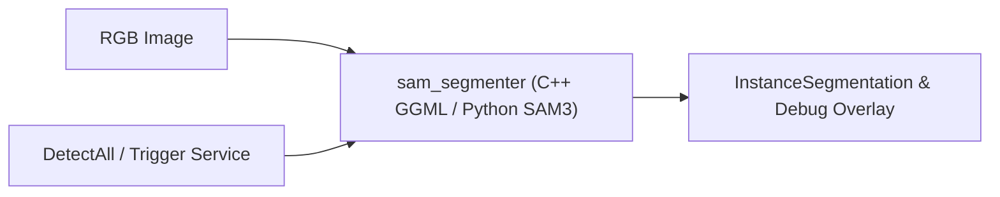

# sam_segmenter

[](https://docs.ros.org/en/humble/) [](LICENSE) [](mailto:teamrobontu@gmail.com)

> **Companion Packages:** Requires `core_r1_interfaces` and `grasp_pipeline` from `public-core-grasp`. Python dependencies: [`requirements.txt`](requirements.txt) (or `public-core-grasp/environment.yml`).

Detector-free text-prompted SAM3 for ROS 2 Humble. `target_object` is required in continuous and trigger modes: for example `cup`, `red cup`, or `cup,bottle`. Each target is a separate prompt; accepted instance masks are combined into a camera-sized binary mask. Names locate all matching instances, rather than selecting one instance for grasping.

The default C++ node loads GGML weights directly. The optional Python node and model worker use the shared `grasp` environment. The worker uses `sam3_python`, loads a local checkpoint once, and accepts one bounded inference request at a time. It imports no ROS libraries. No checkpoint is implicitly downloaded. The upstream image API is described in the [official SAM3 repository](https://github.com/facebookresearch/sam3).


## Architecture



## C++ GGML Engine and Python Backend

`sam_segmenter` provides two interchangeable inference backends:
1. **C++ GGML Engine (`sam3_cpp` / default)**: Native multi-threaded GGML engine using quantized weights (`models/sam3-q4_0.ggml`), with CUDA graph acceleration and mmap-based memory mapping.
2. **Python Worker Backend (`use_python_sam:=true`)**: Out-of-process Python worker using PyTorch/CUDA running native SAM 3 text-conditioned segmentation (`models/sam3.pt`).

Provision models using `scripts/provision_models.sh` (or place `sam3-q4_0.ggml` in `models/`). Relative checkpoint and interpreter parameters resolve against this repository. Large model assets are ignored by Git.

For the Python worker backend, use the unified `environment.yml` from [`Team-Robo/public-core-grasp`](https://github.com/Team-Robo/public-core-grasp):

```bash
PYTHONNOUSERSITE=1 conda env create -f environment.yml
PYTHONNOUSERSITE=1 conda run -n grasp python -m pip check
```

> [!NOTE]
> When building `perc-sam_segmenter` standalone outside `public-core-grasp`, ensure `core_r1_interfaces` (from `public-core-grasp/src/core-r1_interface`) and `grasp_pipeline` (from `public-core-grasp/src/manip-grasp_bringup`) are present in your ROS 2 workspace `src/`.

Source your system ROS Humble installation and build from the workspace root with system Python, not the model interpreter:

```bash
# Inside public-core-grasp:
colcon build --symlink-install --packages-up-to sam_segmenter grasp_bringup \
  --cmake-args -DPython3_EXECUTABLE="$(command -v python3)"

# Or standalone (with core_r1_interfaces and grasp_pipeline in src/):
colcon build --symlink-install --packages-select sam_segmenter \
  --cmake-args -DPython3_EXECUTABLE="$(command -v python3)"
source install/setup.bash
```

Configuration in `src/manip-grasp_bringup/grasp_bringup/config/params.yaml` or `src/perc-sam_segmenter/config/params.yaml`:

```yaml
sam_segmenter_node:
  ros__parameters:
    backend_engine: "sam3_cpp"
    model_family: "sam3"
    model_path: "models/sam3-q4_0.ggml"
    use_gpu: true
    num_threads: 4
    target_object: "cup,bottle"
    single_frame_mode: true
```

```bash
# Continuous mode reuses weights until another neural phase needs the GPU
ros2 launch grasp_bringup perception.launch.py pipeline_mode:=sam target_object:=cup single_frame_mode:=false
# Trigger Mode (Model loads on-demand and unloads after inference)
ros2 launch grasp_bringup perception.launch.py pipeline_mode:=sam target_object:=cup single_frame_mode:=true
ros2 service call /object_pointcloud/trigger std_srvs/srv/Trigger '{}'
# Standalone ROS node with explicit model environment and assets
conda run -n grasp python src/perc-sam_segmenter/scripts/sam3_segmenter_node.py --ros-args \
  -p target_object:=cup \
  -p sam3_checkpoint_path:=models/sam3.pt
```

## Model Lifecycle & Memory Cache Management

To ensure deterministic RAM and VRAM usage without leaks over long runtimes:
* **Continuous Streaming Mode (`single_frame_mode:=false`)**: The model retains idle GPU weights (**HOT**) between SAM frames. A waiting grasp phase can evict SAM to **WARM** before loading its own model; SAM reloads when its next phase begins. GPU phase requests are served in queue order.
* **Trigger / On-Demand Mode (`single_frame_mode:=true`, `always_hot:=false`)**: Controlled via `ModelLifecycleManager`:
  1. Node sits idle in **COLD** state (0 VRAM allocated).
  2. Upon receiving `/sam_segmenter/trigger`, the model file is memory-mapped (**WARM**) and weights/buffers are loaded into GPU VRAM (**HOT**).
  3. The camera frame is encoded and segmented, publishing masks and instances.
  4. Immediately upon completion, the model is unloaded from GPU memory and deallocated (**HOT $\rightarrow$ COLD**), releasing all GPU VRAM and mapped host buffers.
* **Cache & Memory Cleanup**:
  - In both C++ and Python nodes, temporary image tensors, instance mask arrays, and detection lists are explicitly freed immediately after publishing.
  - Python workers retain the CUDA allocator cache by default. Set the Python node parameter `release_cuda_cache:=true` to flush unused CUDA cache and run garbage collection after requests. Live model weights remain allocated.
  - C++ unload synchronizes CUDA and frees GGML contexts. `always_hot:=true` retains the loaded model.
  - Pipeline launch argument `preload_models:=true` loads selected SAM/YOLO, F2G and grasp models at startup and keeps them resident. `false` defers loading; empty preserves backend defaults. This explicit argument overrides native SAM `always_hot`. Python SAM defers its worker when false and reuses it after the first trigger.
* **In-Flight Frame Protection (`inference_header_topic`)**:
  - As soon as neural inference starts on a frame, the node publishes its image header to `/perc/grasp/segmentation_input`.
  - Upstream `object_pointcloud_processor` subscribes to this topic and marks the frame as actively inferring, protecting it from ring-buffer eviction during the ~2.5–3.2 s segmentation period.

## Parameters and interfaces

| Parameter | Default | Behavior |
| --- | --- | --- |
| `backend_engine` | sam3_cpp | Inference engine: `sam3_cpp` (native C++ GGML) or Python worker. |
| `model_path` | models/sam3-q4_0.ggml | Path to GGML model file for C++ engine. |
| `use_gpu` | true | Enable CUDA GPU acceleration for GGML operations. |
| `num_threads` | 4 | CPU thread count for GGML computation. |
| `target_object` | empty (required) | Comma-separated names; whitespace normalized and duplicates removed. Maximum 16 targets, 256 characters each. |
| `single_frame_mode` | true | True for triggered on-demand capture with cold unloading; false for continuous streaming with reusable, evictable weights. |
| `sam_mode` | sam3 | Named-target backend; spatial-prompt backends are not compatible with this node. |
| `sam3_python` | empty | Empty uses the shared environment's interpreter; an explicit path overrides it. |
| `sam3_checkpoint_path` | empty | Required existing local PyTorch checkpoint (when using Python backend). |
| `sam3_device` | cuda | cuda or cpu. No silent CPU fallback. |
| `sam3_confidence_threshold` | 0.5 | Instance threshold in [0,1]. |
| `sam3_bpe_path` | empty | Optional external tokenizer vocabulary. |
| `startup_timeout` | 120 s | Bounded model worker initialization. |
| `acquisition_timeout` | 5 s | Trigger waits for a source RGB stamp newer than its accepted boundary. |
| `inference_timeout` | 10 s | Wall-clock worker request bound; late results are discarded. |
| `max_image_pixels` | 4194304 | Input image bound; rgb8/bgr8 and padded rows supported. |
| `image_topic` | /camera/camera/color/image_raw | RGB input only. |
| `mask_topic` | /perc/grasp/mask | mono8 output, 0 background / 255 target, original RGB header and resolution. |
| `selected_mask_topic` | /perc/grasp/selected_mask | mono8 output for selected target component. |
| `instances_topic` | /perc/grasp/instances | `core_r1_interfaces/msg/InstanceSegmentation` output masks and instance metadata. |
| `detection_topic` | /perc/grasp/detections | Output boxes/text labels for existing visualizers; never an input dependency. |
| `inference_header_topic`| /perc/grasp/segmentation_input | Image header published at inference start to lock buffer frame against eviction. |

`/sam_segmenter/status` publishes JSON in `std_msgs/msg/String`, including model/input readiness, busy state, active targets, last outcome, and error. An absent target produces a fresh zero mask and empty boxes. Trigger returns false with a no-target message. Inference/transport failures remain distinct in status; restart the node after its worker is stopped by a timeout or broken transport. Concurrent triggers fail immediately. `target_object` updates validate atomically, clear old visualizations, and invalidate old-target inference; updates during a trigger fail. Other options are read-only until restart.

Pointcloud conversion buffers and matches the original RGB/depth pair, rather than applying delayed masks to current depth. Size the bounded buffer and downstream grasp acquisition/age limits for measured model latency.

## Deployment verification

Check model readiness, original-image mask dimensions/stamps, empty-target clearing, trigger freshness and RGB/depth alignment on representative camera inputs. Native inference establishes that the worker runs; it does not establish reliable recognition of every target. SAM3 currently performs independent image inference.

## References

- [SAM 3](https://github.com/facebookresearch/sam3) — Meta AI Segment Anything Model 3
- [sam3.cpp (GGML weights)](https://huggingface.co/PABannier/sam3.cpp) — quantized GGML checkpoints for C++ inference
- [GGML](https://github.com/ggml-org/ggml) — tensor library powering the C++ backend

## Contributors

- **Hu Ming Jie** (`@humjie`)
- **Tang Pei Wen** (`@peiwen10`)

Maintained by **Nanyang Technological University Team Robo** (`teamrobontu@gmail.com`).

## License

This project is licensed under the Apache License 2.0 — see the [LICENSE](LICENSE) file for details.
